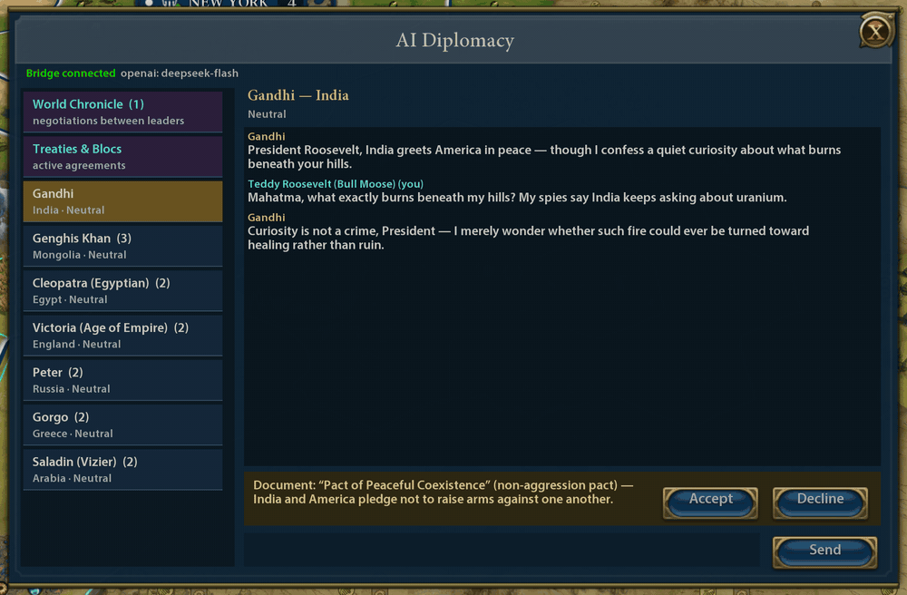
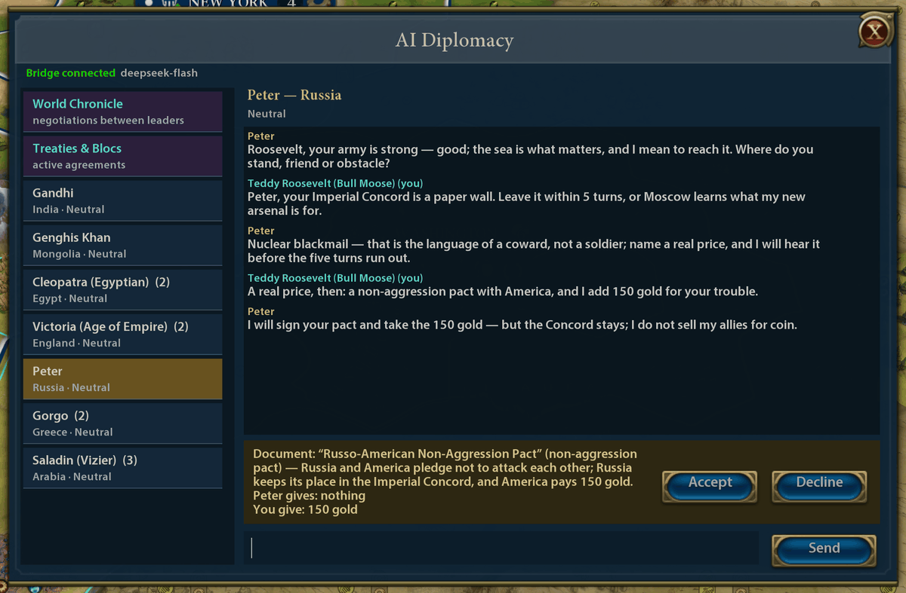
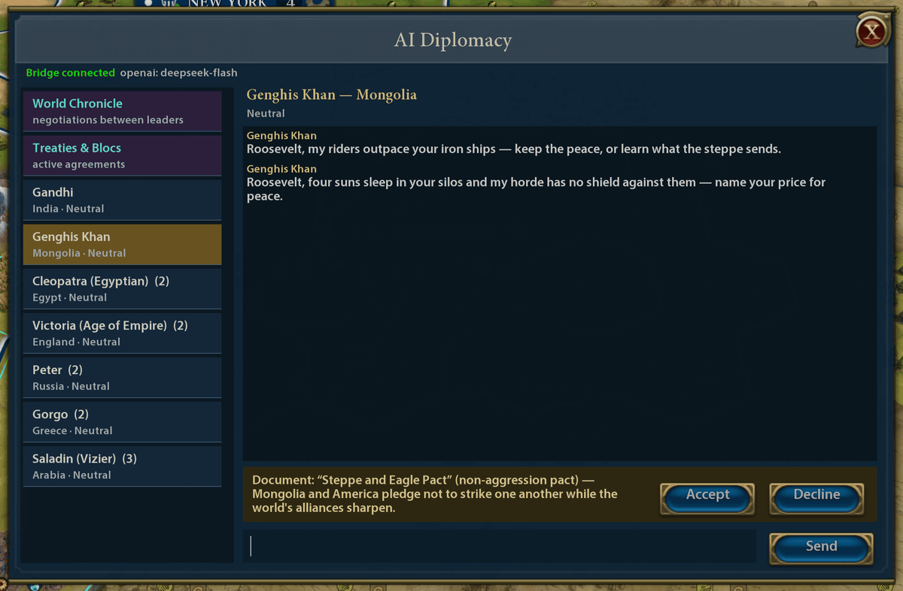
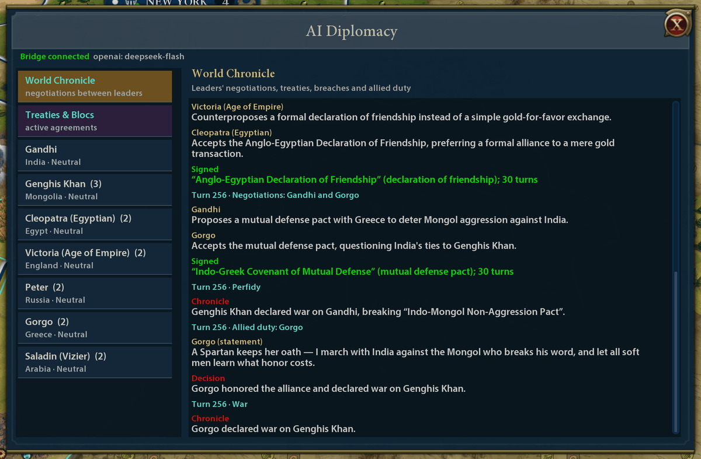
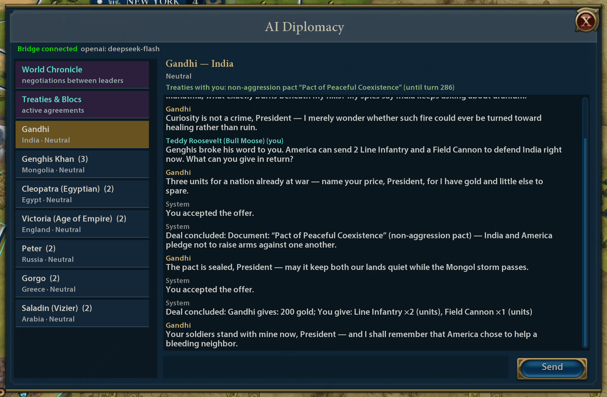
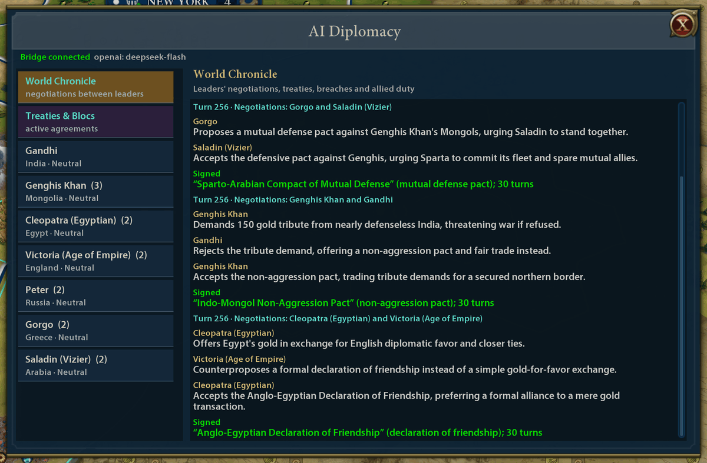
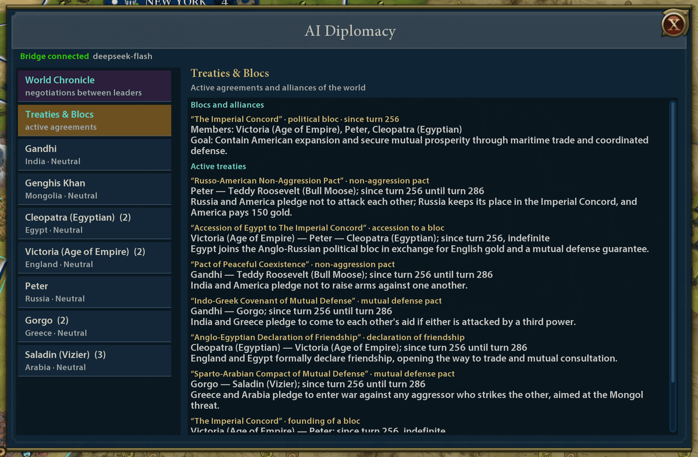

# LLM Leaders — ИИ-лидеры для Civilization VI (Gathering Storm)

[English version](README.md)

> **Язык.** Окно мода — на русском или английском: по языку игры, принудительно задаётся настройкой `ui_language`.
> Язык реплик лидеров, названий документов и сводок хроники задаётся настройкой `language` (например, `русский`).

Лидеры-боты общаются, торгуют и принимают дипломатические решения через языковую модель
(OpenAI, Claude, DeepSeek, OpenRouter, локальная Ollama…). Вы пишете им свободным текстом,
они отвечают уникальными репликами в характере, предлагают сделки, помнят обещания и обиды.

<p align="center">
  
</p>

## Как это устроено

```
Civ 6 + мод (окно чата, события)  ⇄  FireTuner :4318  ⇄  мост (Node.js)  ⇄  LLM API
```

- **Мод** (`mod/LLMLeaders`) — окно «ИИ-дипломатия», очередь событий, сбор состояния игры.
- **Мост** (`bridge`) — опрашивает мод, строит промпты, вызывает LLM, проверяет и исполняет решения
  (золото, ресурсы, благосклонность, война/мир, отношение стандартного ИИ).
- Тактикой (армии, стройка) по-прежнему управляет стандартный ИИ игры.

## Установка

1. Нужен **Node.js 18+** (https://nodejs.org).
2. Запустите `install.bat`: он подключит мод к игре, включит FireTuner и установит зависимости.
   - Если FireTuner не включился автоматически, включите его в игре: *Настройки → Игра → Tuner*.
     Учтите, что с ним **отключаются достижения**.
3. Откройте `bridge\config.yaml` и укажите провайдера, ключ API и модель.

## Запуск

1. Запустите Civ 6 и включите мод **LLM Leaders** в разделе «Дополнения».
2. Начните новую партию или загрузите сохранение.
3. `probe.bat` — проверка связи. Отчёт сохранится в `bridge\probe-report.txt`.
4. `start.bat` — запуск моста. Окно моста держите открытым, пока играете.
5. В игре нажмите кнопку **«ИИ-дипломатия»** вверху экрана.

## Характеры лидеров

Файл `bridge\personas.yaml`: описывайте поведение обычным текстом. Файл перечитывается на лету,
поэтому характер можно менять посреди партии.

## Что умеет

| Возможность | Статус |
|---|---|
| Чат свободным текстом, уникальные реплики | ✅ |
| Лидеры пишут первыми (встреча, война, мир, по своей инициативе) | ✅ |
| Сделки из диалога: золото (разово и за ход), стратегические и люксовые ресурсы, право прохода, благосклонность, войска, ядерные заряды, мир | ✅ |
| Проверка сделок по правилам (нельзя отдать то, чего нет) | ✅ |
| Разговор меняет отношение стандартного ИИ | ✅ |
| Стратегический слой: LLM решает войну, мир и отношения между лидерами | ✅ |
| Лидеры ведут переговоры между собой: меморандумы, торговля, пакты, союзы, блоки | ✅ |
| Нарушение договоров (вероломство), союзнический долг при нападении на партнёра | ✅ |
| «Мировая хроника» (краткие сводки переговоров) и «Договоры и блоки» в окне чата | ✅ |
| Вам тоже предлагают документы: пакты, союзы, вступление в блоки | ✅ |
| Память партии (переписка, обещания, события) — `bridge\data` | ✅ |
| Расторжение договоров прямо в переписке; ваши договоры с лидером видны в окне чата | ✅ |
| Учёт соотношения сил и ядерных арсеналов, реакция мира на ядерные удары | ✅ |
| Перевод характера в SQL-параметры стандартного ИИ | ⏳ позже |

## Мировая дипломатия

Каждый ход одна пара лидеров-ботов ведёт закрытые переговоры (2–3 реплики) в своих характерах. Они могут подписать:

| Документ | Что происходит в игре |
|---|---|
| Меморандум | запись в реестре, отношения лучше |
| Торговое соглашение | передача золота, стратегических ресурсов, благосклонности (разово или за ход) |
| Пакт о ненападении | нападение на партнёра — вероломство: договор нарушен, все узнают |
| Договор о взаимной обороне | при нападении на партнёра второй решает, вступиться ли (может объявить войну агрессору) |
| Декларация о дружбе | настоящая объявленная дружба в игре |
| Союзный договор | дружба + взаимная оборона |
| Учреждение блока / вступление в блок | блок с названием и целью; военный блок защищает своих, агрессора исключают |
| Совместная война | обе стороны объявляют войну третьей державе |
| Мирный договор | прекращение войны |

Всё видно в окне «ИИ-дипломатия»: вверху списка — **«Мировая хроника»** (стенограммы переговоров, итоги, нарушения,
союзнический долг) и **«Договоры и блоки»** (реестр). Лидеры помнят свои переговоры и могут рассказать о них вам.
Вам тоже могут предложить документ — он появится в карточке сделки рядом с кнопками «Принять/Отклонить».

## Скриншоты

Снято в живой партии с английским интерфейсом (модель DeepSeek `deepseek-flash`, характеры из `bridge/personas.yaml`).

| | |
|---|---|
| <br><sub>**Угроза → торг → сделка.** Пётр называет ядерный шантаж трусостью, но подписывает пакт за золото и остаётся в своём блоке.</sub> | <br><sub>**Соотношение сил.** Один и тот же Чингисхан до и после того, как у Америки появилось ядерное оружие.</sub> |
| <br><sub>**Вероломство и союзнический долг.** Чингисхан нарушает пакт о ненападении с Индией, Горго выполняет договор об обороне и объявляет ему войну.</sub> | <br><sub>**Настоящие сделки.** Две линейные пехоты и пушка за 200 золота: после «Принять» юниты и золото действительно переходят.</sub> |
| <br><sub>**Мировая хроника.** Лидеры-боты ведут переговоры между собой, каждый ход — краткая сводка.</sub> | <br><sub>**Договоры и блоки.** Блок, созданный «для сдерживания Америки», и все действующие договоры.</sub> |

<sub>Для демонстрации города, армии и ядерное оружие добавлены через FireTuner, темы переговоров между ботами заданы вручную;
все реплики, документы и решения сгенерированы моделью.</sub>

## Настройки (`config.yaml`)

- `behavior.proactive_*` — как часто лидеры пишут первыми.
- `strategy.enabled / every_turns` — стратегический слой и его частота (влияет на расход токенов).
- `world.enabled / negotiations_per_turn / every_turns` — переговоры лидеров между собой (одни переговоры ≈ 3 запроса к LLM).
- `limits.max_calls_per_turn` — ограничение фоновых запросов за ход.
- `behavior.allow_unmet: true` — показывать невстреченных лидеров (для тестов).

## Если что-то не работает

- **«нет связи с игрой»** — FireTuner не включён, или игра запущена до включения. Перезапустите игру.
  Одновременно к тюнеру может подключиться только одна программа, поэтому закройте FireTuner, если он открыт.
- **«мод не активен»** — включите LLM Leaders в «Дополнениях» **до** старта партии.
- **Ошибка LLM** — проверьте ключ, модель и `base_url`. Если провайдер не поддерживает
  режим JSON, поставьте `json_mode: false`.

## Участие в разработке

Приветствуются любые вклады: сообщения об ошибках, характеры лидеров, переводы, улучшение промптов, новые виды сделок,
доработка интерфейса. Как настроить окружение и правила — в [CONTRIBUTING.md](CONTRIBUTING.md) (на английском).

## Лицензия

[MIT](LICENSE) — можно свободно использовать, изменять и распространять, в том числе в коммерческих целях,
сохраняя уведомление об авторских правах.
